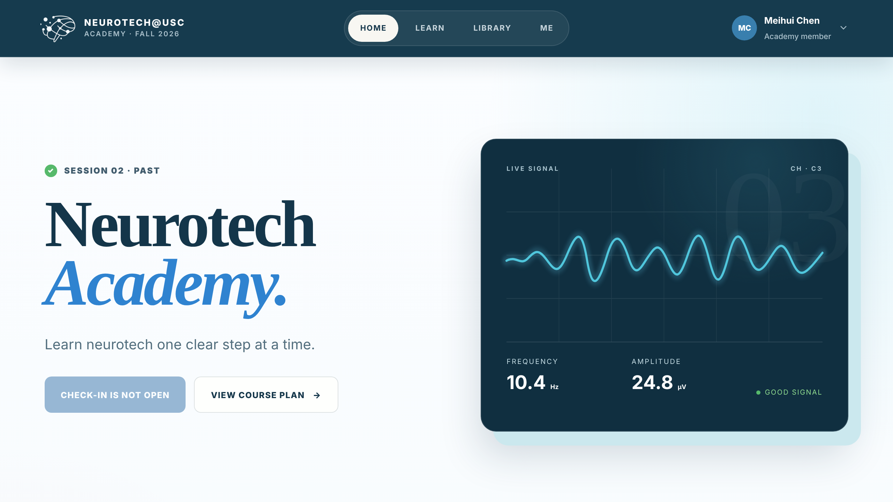

# Neurotech@USC Academy


**Live site: [neurotechacademy.web.app](https://neurotechacademy.web.app)**

The learning portal for the NeuroTech@USC Academy, a weekly one-hour session
series that takes students from any major from neurotechnology basics to
building their own projects: *from raw EEG to a BCI you can explain.* Each
session comes with a worksheet, and the portal keeps the course plan, materials,
and each member's progress in one place between sessions.



## What's inside

**For members**
- **Home**: the next session, what to prepare, and your progress through the course
- **Learn**: the course plan, organized as a connected sequence of sessions
- **Library**: searchable and filterable materials, including current and past sessions and outside resources such as MNE tutorials and an EEG starter notebook
- **Me**: your participation record and project readiness
- Session check-in with a code shared in the room

**For organizers**
- An admin dashboard with a live check-in view and roster
- Role-based access: organizers are recognized after Google sign-in

## Built with

Plain HTML, CSS, and JavaScript with no build step, plus Firebase for Google
sign-in, data, and hosting.

| file | purpose |
|---|---|
| `index.html`, `app.js` | the portal |
| `styles.css`, `library-theme.css` | styling |
| `firebase-config.js` | Firebase project and organizer emails |
| `firestore.rules` | database access rules |
| `firebase.json` | hosting configuration |
| `assets/` | logo and badge artwork |

## Run locally

Open `index.html` in a browser, or serve the folder with any static server:

```bash
python -m http.server 8000
```

Google sign-in needs the site to be served over HTTP (or deployed). Without it,
use the **Enter as learner** or **Enter as admin** buttons on the sign-in screen
to explore with demo data; they use local browser storage only. The demo
check-in code is `241008`.

## Configure and deploy

1. Add organizer emails (lowercase) to `NEUROTECH_ADMIN_EMAILS` in `firebase-config.js`.
2. Protect data with `firestore.rules`. The client-side email list only controls
   which interface is shown; the rules are what actually restrict access.
3. Replace placeholder resource links with your Google Drive, Slides, Colab, and Form URLs.
4. Deploy with `firebase deploy --only hosting`.

---

Designed and built by Meihui (Lily) Wu, Director of Education, NeuroTech@USC.
